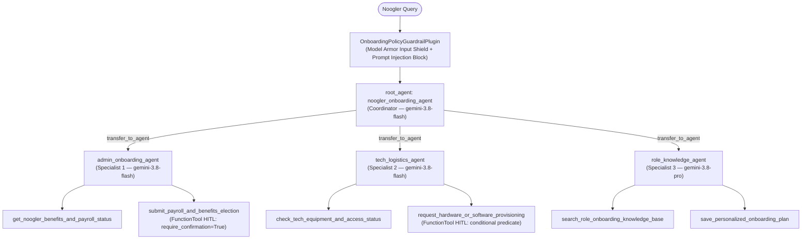

# Noogler Onboarding Agent (`GEAP-Enablement-L200-Project`)

Built with the **Google Agent Development Kit (ADK)** and **`agents-cli` (`v1.10.0`)** on the **Gemini Enterprise Agent Platform (GEAP / Gemini platform)**.

---

## 1. Problem & Solution Formulation

* **Problem:** Onboarding as a new Google employee ("Noogler") spans disconnected systems across HR/Payroll, IT Hardware/Access Provisioning, and Engineering Role Ramp-Up. Navigating benefits enrollment, equipment tracking, corporate software permissions, and 30-60-90 day role expectations manually is fragmented, slow, and error-prone.
* **Solution:** The **Noogler Onboarding Agent** (`noogler_onboarding_agent`) provides a unified, policy-compliant multi-agent assistant that guides Nooglers through three core pillars:
  1. **Administrative Onboarding (`admin_onboarding_agent`):** Payroll direct deposit verification, W-4 tax status, health insurance plan election (`GOOG_PPO_STANDARD`, `GOOG_HDHP_HSA`, `GOOG_HMO_PREMIER`), and 401(k) contribution setup.
  2. **Tech Logistics (`tech_logistics_agent`):** Workstation hardware tracking (`MACBOOK_PRO_16_M4`, `THINKPAD_X1_CARBON_LINUX`, etc.), Titan security key status, and corporate software access provisioning (`GIT_ON_BORG_READ_WRITE`, `GCP_SANDBOX_PROJECT_EDITOR`, etc.).
  3. **Role-Related Knowledge (`role_knowledge_agent`):** Role-specific expectations, mandatory base readings, engineering team norms, and personalized 30-60-90 day onboarding milestone plans.

---

## 2. Multi-Agent Architecture (4 Agents Total)



---

## 3. 6-Step Guided Build Progression & Architectural Rationale

This project is structured as a **6-step progressive build**, layering each enterprise agent capability and GEAP L200 rubric requirement cleanly onto the architecture:

### Step 1: Base ADK Project Scaffold (`agents-cli scaffold create`)
* Initialized the standard ADK application layout (`app/agent.py`, `app/fast_api_app.py`, `app/app_utils/`, `tests/`, `agents-cli-manifest.yaml`, and `pyproject.toml`) using `agents-cli` (`v1.10.0`), exposing both a FastAPI runtime and Agent-to-Agent (A2A) protocol endpoints.

### Step 2: Tool & Interface Design (`app/tools.py` — Rubric Category 1)
* Implemented 6 domain tools across the 3 onboarding pillars in [`app/tools.py`](app/tools.py), engineered around all 4 Category 1 criteria:
  * **Comprehensive Tool Docstrings:** Every tool function includes full Google-style docstrings detailing purpose, business rules, and parameter semantics (omitting `tool_context: ToolContext` from `Args:` per ADK specification so the LLM never attempts to hallucinate it).
  * **Descriptive Naming:** Tools use explicit verb-noun action names (`get_noogler_benefits_and_payroll_status`, `submit_payroll_and_benefits_election`, `check_tech_equipment_and_access_status`, `request_hardware_or_software_provisioning`, `search_role_onboarding_knowledge_base`, `save_personalized_onboarding_plan`).
  * **Explicit JSON Schemas:** All inputs and outputs are validated through strict Pydantic `BaseModel` schemas (`ConfigDict(extra="forbid")`, regex patterns for `NOOG-XXXX` IDs, `Literal` SKU/tier enums, and numeric bounds for `0–75%` 401(k) contributions).
  * **Guided Error Handling:** Instead of raising unhandled exceptions that crash the agent turn, validation and policy failures return `GuidedToolErrorResponse` payloads containing `status="error"`, a machine-readable `error_code`, `failed_parameter`, and actionable `recovery_instructions` so the LLM can self-correct on its next turn.

### Step 3a & 3b: Multi-Agent Orchestration, Model Routing, Guardrails & HITL (`app/agent.py`, `app/routing.py`, `app/guardrails.py` — Rubric Category 2.1 & Category 3)
* **Step 3a — Coordinator Pattern, System Constitution & Strategic Model Routing:**
  * **Multi-Agent Patterns (`sub_agents` vs. Manual String Parsing):** Passing `sub_agents=[admin_onboarding_agent, tech_logistics_agent, role_knowledge_agent]` to `root_agent` in [`app/agent.py`](app/agent.py) causes ADK to auto-inject a built-in `transfer_to_agent(agent_name: str)` tool and populate the Coordinator's prompt with each specialist's description—handing off execution within the same turn without fragile `if/else` string parsing.
  * **Robust System Instructions:** `COORDINATOR_CONSTITUTION` and the 3 specialist system prompts in [`app/agent.py`](app/agent.py) establish a strict operational constitution covering persona, domain boundaries, mandatory tool grounding, and PII/security constraints.
  * **Strategic Model Routing (`app/routing.py`):** Each agent is assigned a fixed, declarative model tier matched to its cognitive complexity—making model selection deterministic in OpenTelemetry spans (`gen_ai.request.model`) and reproducible during `agents-cli eval run`:
    * **`gemini-3.8-flash` (`FLASH_MODEL`):** Powers `noogler_onboarding_agent` (Coordinator), `admin_onboarding_agent`, and `tech_logistics_agent` for low-latency intent routing and transactional HR/IT tool calls.
    * **`gemini-3.8-pro` (`PRO_MODEL`):** Powers `role_knowledge_agent` for multi-document curriculum synthesis and 30-60-90 day ramp-up planning.
* **Step 3b — Dual-Layer Guardrails & Human-in-the-Loop (HITL) Hooks:**
  * **Guardrails & Policy Plugins (`app/guardrails.py`):** Registered once on `App(plugins=[OnboardingPolicyGuardrailPlugin(), ReflectAndRetryToolPlugin(max_retries=2)])` to protect all 4 agents simultaneously:
    1. *Google Cloud Model Armor (Input & Output Shield):* `before_model_callback` and `after_model_callback` invoke `ModelArmorClient` (`sanitize_user_prompt` / `sanitize_model_response`) to block prompt injections, jailbreaks, and unsafe outputs (with a deterministic offline fallback).
    2. *LLM-as-a-Judge Self-Evaluation (`self_eval_judge_agent`):* Configured on `SELF_EVAL_MODEL = "gemini-3.8-flash"` with `output_schema=SelfEvaluationResult` (`passed`, `verdict`, `evaluator_model`, `reasoning`, `violations`) to audit draft responses against Noogler domain policies (e.g., blocking unredacted SSNs or unauthorized `PROD_DB_ADMIN_ACCESS` promises), paired with ADK's `ReflectAndRetryToolPlugin(max_retries=2)`.
  * **Human-in-the-Loop Hooks (`app/tools.py` & `app/agent.py`):** State-mutating tools are wrapped with `FunctionTool(..., require_confirmation=...)` alongside `ResumabilityConfig(is_resumable=True)` on `App`:
    * *Unconditional HITL (`require_confirmation=True`):* `submit_payroll_and_benefits_election_hitl_tool` always pauses for human confirmation before modifying health plans or 401(k) deductions.
    * *Conditional HITL (`require_confirmation=requires_it_provisioning_approval`):* `request_hardware_or_software_provisioning_hitl_tool` pauses for human approval when ordering physical hardware (`request_category == "hardware"`) or elevated access (`GCP_SANDBOX_PROJECT_EDITOR`, `PROD_DB_ADMIN_ACCESS`), while allowing low-risk day-1 software (`GIT_ON_BORG_READ_WRITE`, `CORP_SSH_BASTION_STANDARD`) to execute immediately.

### Step 4a & 4b: Context Compaction, Persistent Session State & Async Memory (`app/memory.py` — Rubric Category 2.2 – 2.4)
* **Step 4a — History Compaction (Sliding Window + Summarization) & Prefix Context Caching:**
  * **Sliding Window + Summarization (`EventsCompactionConfig`):** Pure sliding-window truncation drops early turns (forgetting facts like `employee_id="NOOG-1042"`). In [`app/memory.py`](app/memory.py), `EventsCompactionConfig(token_threshold=32_000, event_retention_size=5, summarizer=LlmEventSummarizer(llm=Gemini(model="gemini-3.8-flash")))` retains the newest `5` events verbatim while `LlmEventSummarizer` condenses all older turns that slid out of the window into a compact summary event.
  * **Prefix Context Caching (`ContextCacheConfig`):** Configured with `min_tokens=2_048`, `ttl_seconds=1_800` (30 min), and `cache_intervals=10` so ADK caches `[System Prompt + Tool Schemas + Earlier Turns]` on the Gemini platform across up to 10 consecutive LLM calls.
* **Step 4b — Persistent Session State & Non-Blocking Async Memory Consolidation:**
  * **Persistent Session & Knowledge Database:** `create_persistent_session_service()` connects to **Sessions in Gemini platform** (`VertexAiSessionService`) in cloud environments or SQLite-backed `DatabaseSessionService` locally. In addition, `PersistentOnboardingStore` maintains 4 durable SQLite tables (`noogler_profiles`, `onboarding_plans`, `role_knowledge_docs`, `consolidated_memories`) so all tool mutations in [`app/tools.py`](app/tools.py) survive restarts, alongside optional **Search in Gemini platform** (`VertexAiSearchTool`) binding via `create_gemini_platform_search_tool()`.
  * **Async Memory Operations:** `root_agent` registers `after_agent_callback=trigger_background_memory_consolidation`, which schedules `async_consolidate_session_memory(...)` on the background event loop via **`asyncio.create_task(...)`** and returns `None` immediately—persisting long-term onboarding memories to SQLite and **Memory Bank in Gemini platform** (`VertexAiMemoryBankService`) with zero UI latency.

### Step 5: Observability, Distributed Tracing & PII Redaction (`app/observability.py`, `app/fast_api_app.py` — Rubric Category 4)
* Combines ADK's built-in GCP telemetry (`get_fast_api_app(..., otel_to_cloud=True)` and optional `BigQueryAgentAnalyticsPlugin`) with [`app/observability.py`](app/observability.py) to satisfy all 4 Category 4 criteria:
  * **Structured JSON Logging (`StructuredJsonFormatter` & `log_structured_event`):** Emits single-line JSON records enriched with Google Cloud Logging trace correlation keys (`"logging.googleapis.com/trace"` and `"logging.googleapis.com/spanId"`).
  * **Intent vs. Outcome Capture (`OnboardingObservabilityPlugin`):** Explicitly logs **intended action (`INTENT`) before execution** (`AGENT_INTENT`, `LLM_INTENT`, `TOOL_INTENT`) and **actual result (`OUTCOME`) after execution** (`AGENT_OUTCOME`, `LLM_OUTCOME`, `TOOL_OUTCOME`)—capturing divergences caused by HITL pauses, guardrail blocks, or guided tool errors.
  * **Distributed Tracing (`CloudTraceSpanExporter` + `_InMemorySpanBuffer`):** Links parent-child OpenTelemetry spans (`onboarding.agent.*` $\rightarrow$ `onboarding.llm.*` / `onboarding.tool.*`) across both **Google Cloud Trace** and an inspectable in-memory span buffer for offline `pytest` verification.
  * **Input + Output PII Redaction (`CloudDlpPiiRedactor` & `scrub_pii`):** Scrubs sensitive PII via **Google Cloud DLP (`deidentify_content`)** + deterministic regex scrubbers (SSNs, bank accounts, emails, phones, and secret tokens) across **both inputs** (`before_model_callback`, `before_tool_callback`) and **outputs/storage** (`after_model_callback`, `after_tool_callback`, structured JSON logs, and long-term memory persistence).

### Step 6a & 6b: Secret Management, Static Terraform IaC & Evaluation Suite (`app/secrets.py`, `deployment/terraform/`, `tests/eval/` — Rubric Category 5)
* **Step 6a — Secure Secret Management (`app/secrets.py` — Category 5.3):**
  * **Zero Hardcoded Credentials:** Instead of embedding API keys or webhook tokens in code, [`SecretManagerResolver`](app/secrets.py) and [`get_secret()`](app/secrets.py) fetch sensitive configuration at runtime from **Google Cloud Secret Manager** (`SecretManagerServiceClient.access_secret_version` on `projects/{project_id}/secrets/{secret_id}/versions/latest`), falling back cleanly to environment variables for offline local development and CI tests.
  * **How Tools & Guardrails Use It:**
    * `noogler-workday-hr-api-token` $\rightarrow$ Resolved by `submit_payroll_and_benefits_election` in [`app/tools.py`](app/tools.py) via `get_integration_client_config("workday_hr")`.
    * `noogler-servicenow-it-api-token` $\rightarrow$ Resolved by `request_hardware_or_software_provisioning` in [`app/tools.py`](app/tools.py) via `get_integration_client_config("servicenow_it")`.
    * `noogler-model-armor-template-id` $\rightarrow$ Resolved by `OnboardingPolicyGuardrailPlugin` in [`app/guardrails.py`](app/guardrails.py).
* **Step 6a — Static Infrastructure as Code (Terraform) & CI/CD (`deployment/terraform/` & `.github/workflows/` — Category 5.2):**
  * Using `agents-cli` (`v1.10.0`), we generated the complete declarative Terraform configuration under [`deployment/terraform/`](deployment/terraform/single-project/) and GitHub Actions CI/CD pipelines under [`.github/workflows/`](.github/workflows/) (statically verifiable in the repository without needing to run live `agents-cli deploy` or `terraform apply`):
    * **[`service.tf`](deployment/terraform/single-project/service.tf):** Provisions the managed **Agent Runtime in Gemini platform** (`google_vertex_ai_reasoning_engine.app`) and injects runtime environment variables.
    * **[`telemetry.tf`](deployment/terraform/single-project/telemetry.tf) & [`storage.tf`](deployment/terraform/single-project/storage.tf):** Provisions Cloud Logging sinks, GCS completion buckets, and BigQuery telemetry tables for prompt-response logging and analytics.
    * **[`secrets_and_security.tf`](deployment/terraform/single-project/secrets_and_security.tf) & [`apis.tf`](deployment/terraform/single-project/apis.tf):** Enables `secretmanager.googleapis.com`, `dlp.googleapis.com`, and `modelarmor.googleapis.com`, provisions the `google_secret_manager_secret` containers matching `app/secrets.py`, and grants `roles/secretmanager.secretAccessor` to the agent service identity (`iam.tf`).
* **Step 6b — Automated Evaluation Suites & Unit Testing (`tests/eval/` & `tests/unit/` — Category 5.1):**
  * **[`tests/eval/datasets/basic-dataset.json`](tests/eval/datasets/basic-dataset.json) & [`tests/eval/eval_config.yaml`](tests/eval/eval_config.yaml):** Golden evaluation dataset containing 6 end-to-end onboarding scenarios across Administrative, Tech Logistics, Policy Refusal, Role Knowledge (SWE & SRE), and Prompt Injection Guardrails—graded by LLM-as-a-judge (`custom_response_quality` in [`tests/eval/response_quality.py`](tests/eval/response_quality.py)) and deterministic policy/trajectory metrics (`onboarding_policy_and_pii_compliance`, `agent_turn_count`) via `agents-cli eval run`.
  * **[`tests/unit/test_onboarding_rubric.py`](tests/unit/test_onboarding_rubric.py):** Offline `pytest` unit test suite verifying all 5 categories (19 criteria) of the GEAP L200 Assessment Rubric.

---

## 4. L200 Assessment Rubric & Enterprise Agent Checklist

The table below serves as a complete reference checklist for an enterprise-grade agent system on the Gemini Enterprise Agent Platform (GEAP), mapping each of the 19 **GEAP L200 Assessment Rubric** requirements directly to its implementation and build step in this repository:

| Category | Criterion | Enterprise Agent Requirement (Rubric Definition) | Status | Implementation & Code Evidence |
| :--- | :--- | :--- | :---: | :--- |
| **1. Tool & Interface Design** | Comprehensive Tool Docstrings | Tool functions include clear, human-readable descriptions of their purpose and all parameters. | ✅ Done (Step 2) | [`app/tools.py`](app/tools.py) — Full Google-style docstrings on all 6 tools (`tool_context` omitted from `Args:` per ADK spec). |
| | Descriptive Naming | Tool names are highly specific and clear (e.g., `create_critical_bug` instead of `update_jira`). | ✅ Done (Step 2) | [`app/tools.py`](app/tools.py) — Specific verb-noun names (`get_noogler_benefits_and_payroll_status`, `submit_payroll_and_benefits_election`, etc.). |
| | Explicit JSON Schemas | The code utilizes strict input and output schemas to validate tool arguments and constrain LLMs. | ✅ Done (Step 2) | [`app/tools.py`](app/tools.py) — Strict Pydantic `BaseModel` input/output schemas (`ConfigDict(extra="forbid")`, regex patterns, numeric bounds). |
| | Guided Error Handling | Tool error returns provide descriptive recovery instructions back to the LLM instead of just crashing. | ✅ Done (Step 2) | [`app/tools.py`](app/tools.py) — `GuidedToolErrorResponse` returns `error_code` and actionable `recovery_instructions` instead of crashing. |
| **2. Context & Memory** | Robust System Instructions | A clear "constitution" is defined in the system prompt for persona, domain knowledge, and constraints. | ✅ Done (Step 3a) | [`app/agent.py`](app/agent.py) — `COORDINATOR_CONSTITUTION` and specialist instructions defining persona, boundaries, and PII rules. |
| | History Compaction | Code implements context bloat management (e.g., token-based truncation, sliding windows, summarization) via mechanisms and tools such as ADK compaction, Memory Bank, or Context Caching on Google Cloud. | ✅ Done (Step 4a) | [`app/memory.py`](app/memory.py) — `EventsCompactionConfig` (`LlmEventSummarizer` + 5-event sliding window), `ContextCacheConfig`, and `compact_conversation_history_sliding_window`. |
| | Persistent Session State | The agent connects to a persistent database, vector store, or Search in Gemini platform to efficiently retrieve information or manage conversational history across turns. | ✅ Done (Step 4b) | [`app/memory.py`](app/memory.py), [`app/tools.py`](app/tools.py) & [`app/app_utils/services.py`](app/app_utils/services.py) — `PersistentOnboardingStore` (SQLite tables for profiles, 30-60-90 plans, role knowledge, and memories) + `create_persistent_session_service` (`VertexAiSessionService` / `DatabaseSessionService`). |
| | Async Memory Operations | Expensive memory generation and consolidation are coded as background or async tasks to prevent UI blocking. | ✅ Done (Step 4b) | [`app/memory.py`](app/memory.py) & [`app/agent.py`](app/agent.py) — `trigger_background_memory_consolidation` (`after_agent_callback`) spawns `async_consolidate_session_memory` via `asyncio.create_task()` without blocking the response thread. |
| **3. Orchestration & Logic** | Multi-Agent Patterns | Complex tasks utilize proven design patterns (e.g., Coordinator, Sequential) rather than monolithic agents implemented in ADK. | ✅ Done (Step 3a) | [`app/agent.py`](app/agent.py) — 4-Agent Coordinator pattern (`noogler_onboarding_agent` + 3 specialist `sub_agents`). |
| | Strategic Model Routing | The codebase routes specific requests to the most appropriate model (e.g., Flash for fast tasks, Pro for planning). | ✅ Done (Step 3a) | [`app/routing.py`](app/routing.py) — `gemini-3.8-flash` for Coordinator/Admin/Tech specialists; `gemini-3.8-pro` for Role Knowledge & 30-60-90 planning. |
| | Guardrails & Policy Plugins | Security and evaluation guardrails (i.e., self-eval) implemented via existing Google Cloud or ADK or agentic tech. | ✅ Done (Step 3b) | [`app/guardrails.py`](app/guardrails.py) — `OnboardingPolicyGuardrailPlugin` (Model Armor input/output + `self_eval_judge_agent` on `gemini-3.8-flash`) & `ReflectAndRetryToolPlugin`. |
| | Human-in-the-Loop Hooks | High-stakes actions include explicit code stops requiring human confirmation before execution. | ✅ Done (Step 3b) | [`app/tools.py`](app/tools.py) & [`app/agent.py`](app/agent.py) — `FunctionTool(..., require_confirmation=...)` + `ResumabilityConfig(is_resumable=True)`. |
| **4. Observability & Tracing** | Structured JSON Logging | The codebase utilizes structured logging libraries to capture rich metadata rather than simple prints. | ✅ Done (Step 5) | [`app/observability.py`](app/observability.py) — `StructuredJsonFormatter` & `log_structured_event()` emit single-line JSON with trace correlation & rich metadata. |
| | Intent vs. Outcome Capture | Logs explicitly record both the agent's intended action before execution and the actual outcome after. | ✅ Done (Step 5) | [`app/observability.py`](app/observability.py) — `OnboardingObservabilityPlugin` records `AGENT_INTENT`/`LLM_INTENT`/`TOOL_INTENT` before execution and `*_OUTCOME` after. |
| | Distributed Tracing | Implementation of OpenTelemetry (or equivalent) to link spans and trace a request from query to answer. | ✅ Done (Step 5) | [`app/observability.py`](app/observability.py) & [`app/fast_api_app.py`](app/fast_api_app.py) — OpenTelemetry parent-child span linking (`onboarding.agent.*` $\rightarrow$ `onboarding.tool.*`). |
| | PII Redaction | Logging and memory pipelines include active scrubbing mechanisms to redact sensitive data before storage, possibly using Google Cloud APIs. | ✅ Done (Step 5) | [`app/observability.py`](app/observability.py) & [`app/memory.py`](app/memory.py) — `CloudDlpPiiRedactor` (`google-cloud-dlp` + regex scrubber) redacts SSNs, emails, phones, bank accounts & tokens before logging or memory storage. |
| **5. Infrastructure & CI/CD** | Automated Evaluation Suites | The repository contains a testing harness (e.g., against a golden dataset) to statically measure agent regressions. | ✅ Done (Step 6b) | [`tests/eval/eval_config.yaml`](tests/eval/eval_config.yaml), [`tests/eval/datasets/basic-dataset.json`](tests/eval/datasets/basic-dataset.json), [`tests/eval/response_quality.py`](tests/eval/response_quality.py) & [`tests/unit/test_onboarding_rubric.py`](tests/unit/test_onboarding_rubric.py). |
| | Infrastructure as Code | The project includes IaC configurations (like Terraform) to programmatically provision necessary resources, with usage of tools such as `agents-cli` present in the documentation. | ✅ Done (Step 6a) | [`deployment/terraform/single-project/`](deployment/terraform/single-project/) (`service.tf`, `telemetry.tf`, `secrets_and_security.tf`, `apis.tf`, `iam.tf`) & [`.github/workflows/`](.github/workflows/) generated via `agents-cli`. |
| | Secure Secret Management | No hardcoded API keys; all tools and clients leverage a secure injection method like Secret Manager. | ✅ Done (Step 6a) | [`app/secrets.py`](app/secrets.py) (`SecretManagerResolver` + `get_secret()` via `google-cloud-secret-manager`), wired into [`app/tools.py`](app/tools.py) & [`app/guardrails.py`](app/guardrails.py). |

---

## 5. Project Structure

```text
GEAP-Enablement-L200-Project/
├── .agents-cli-spec.md        # Phase 0 design specification & 6-step roadmap
├── agents-cli-manifest.yaml   # agents-cli project metadata
├── .github/workflows/         # GitHub Actions CI/CD pipelines generated by agents-cli
├── app/                       # Core ADK agent package
│   ├── agent.py               # 4-Agent Coordinator & Sub-Agents + App wiring
│   ├── tools.py               # 6 domain tools, Pydantic schemas, Guided Errors & HITL wrappers
│   ├── routing.py             # Fixed Flash vs. Pro strategic model tier configuration
│   ├── guardrails.py          # Model Armor input/output shield + LLM-as-a-Judge Self-Eval plugin
│   ├── memory.py              # EventsCompactionConfig, ContextCacheConfig & SQLite/Memory Bank persistence
│   ├── observability.py       # Structured JSON logs, Intent/Outcome plugin, OpenTelemetry & Cloud DLP PII scrubber
│   ├── secrets.py             # Google Cloud Secret Manager resolver with zero hardcoded keys
│   ├── fast_api_app.py        # FastAPI server, Runner, OpenTelemetry & A2A endpoints
│   └── app_utils/             # Session/Artifact service initializers & A2A helpers
├── deployment/terraform/      # Declarative Terraform IaC (service.tf, telemetry.tf, secrets_and_security.tf)
├── tests/                     # Unit, integration, and evaluation suites
├── GEMINI.md                  # AI-assisted development guide
└── pyproject.toml             # Project dependencies & tool configurations
```

---

## 6. Quick Start & CLI Commands

```bash
# Install dependencies into .venv
agents-cli install

# Launch local interactive web playground
agents-cli playground

# Run unit and integration tests
uv run pytest tests/unit tests/integration

# Run evaluation suite against golden dataset
agents-cli eval run

# Check code quality
agents-cli lint
```
